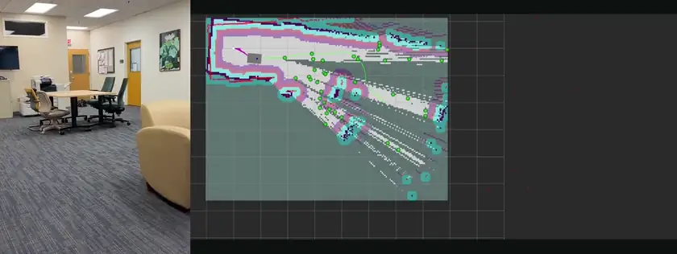
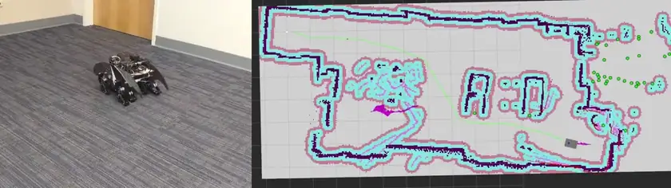
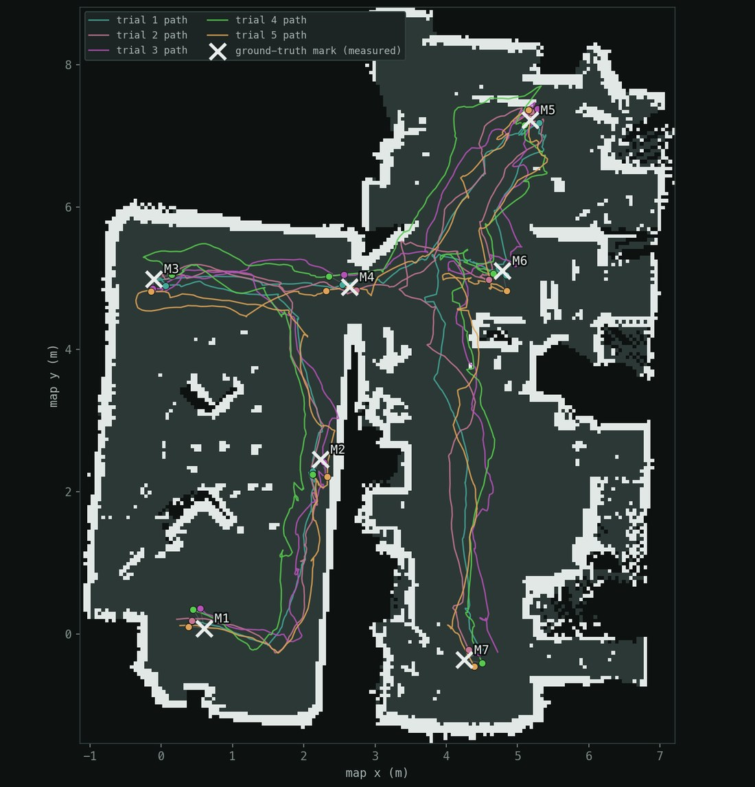
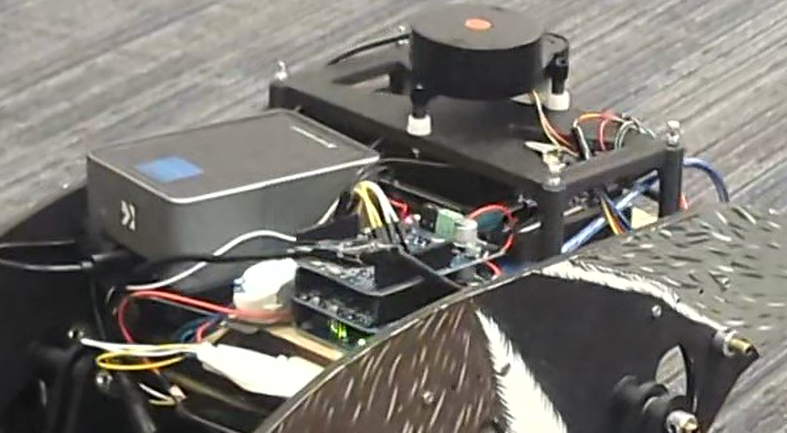
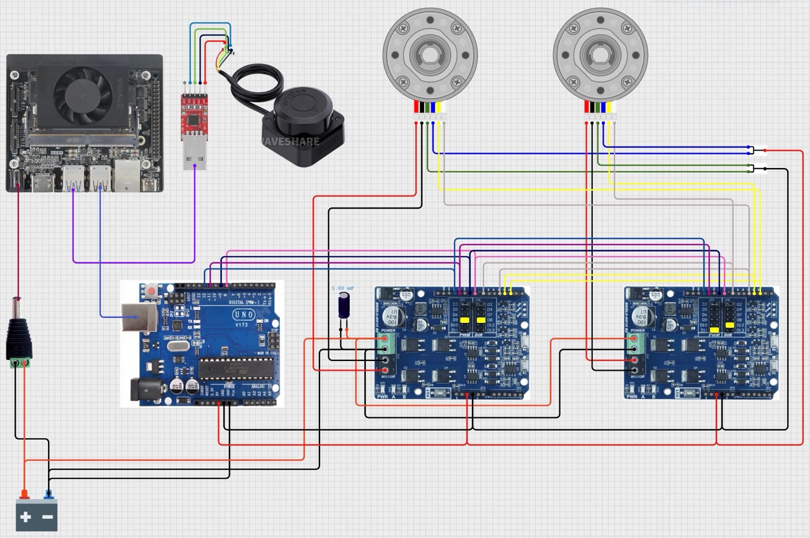

# SlamWalker —— 步行机器人上的激光 SLAM 与导航

[English](README.md) | **中文**

现成的导航栈默认机器人有轮子。这台底盘是**走路的** —— 六杆机构（six-bar linkage），启动死区大、每个步态周期都会顿一下、脚会打滑，所以里程计不可靠。本仓库是让它照样能建图、能导航的整套 ROS 2 系统：电气集成与 Arduino 固件、标定过的里程计桥接、slam_toolbox + AMCL + Nav2、一个把"转弯对步行机器有多贵"算进去的前沿探索器（frontier explorer），以及自制的 RViz 操作面板。

<p align="center">
  
</p>
<p align="center"><sub>自主前沿探索 —— 没有人在遥控。左：机器人；右：同一段 130 秒里它建出的地图（6 倍速）。</sub></p>

> **项目背景** —— 大连理工大学本科毕业设计，在 UC Irvine 的 McCarthy 教授实验室完成，2026 年 1 月 – 5 月。步行平台是实验室按一个已有六杆设计搭的；**让它能导航的部分全是我做的**：电气集成、20 Hz 固件、参数辨识、ROS 2 / Nav2 系统、前沿效用函数及其消融实验、以及实地误差测量。
> 带视频的完整介绍：[krisxia.com/slam](https://krisxia.com/slam.html)

## 结果

| | |
|---|---|
| **定位 RMSE（AMCL，真机）** | **0.211 m** —— 均值 0.199 m，95 分位 0.311 m，N = 35，只用编码器里程计 + 激光雷达，没有 IMU |
| **累计转角**（仿真消融） | **−44%** —— 1899° → 1056° |
| **路径长度**（仿真消融） | **−36%** —— 20.97 m → 13.49 m |
| **地图覆盖率**（仿真消融） | 75.8% → **82.4%** |

后三行来自**仿真中**的 2 × 2 实验（转角惩罚 开/关 × 理想物理 / 步行机构物理，每组 5 次）；上表是步行物理那一组的结果。

## 第一阶段 —— 考虑运动方式的前沿探索

经典前沿规则（Yamauchi 1997、`explore_lite`）只按距离和信息增益给候选点打分。对轮式底盘这没问题 —— 原地转向几乎不花代价。对六杆步行机器来说，这却是最贵的动作：它会打滑，多走很多冤枉路，而且每次打滑都会污染定位所依赖的里程计。所以效用函数里显式加了一项转角惩罚：

```
U = γ · 信息增益 − α · 距离 − β · |航向变化|
```

β = 0 时探索器退化成 `explore_lite` 风格的基线，消融实验就是这样做的。在步行物理的仿真里，β = 2.5 把累计转角降了 44%、路径长度降了 36%，覆盖率反而**上升** —— 说明机器人并不是提早放弃了。真机上调好的权重在 `src/slamwalker_explore/config/explore.yaml`。

除了效用函数，`frontier_explorer_node.py` 还处理了真实房间里会遇到的情况：前沿聚类并按最小信息增益筛选、把每个目标吸附到所在聚类代价最低的格子上（不让目标落进膨胀层）、目标超时与无进展检测、防止目标来回切换的迟滞，以及没有可达前沿时自动保存地图。

## 第二阶段 —— 在保存的地图上导航

<p align="center">
  
</p>
<p align="center"><sub>用 AMCL 在保存的地图上做目标点导航（已加速）。左：机器人；右：规划路径和实时位姿。</sub></p>

slam_toolbox 做图优化 SLAM，AMCL 在保存的地图上定位，Nav2 用 DWB 局部控制器和行为树导航器（探索阶段全局规划用 Smac 2D，在保存地图上用 NavFn），全部按这台最高速度只有 **0.10 m/s** 的机器重新调过。

**难点在模型，不在软件栈。** 教科书上的差速运动学描述不了这台机器，所以我没有相信名义几何参数，而是实测了让模型和样机对上的四个量：

| 参数 | 数值 | 位置 |
|---|---|---|
| 每米编码器计数 | **15 623.1**（几何值的 1.57 倍） | `slamwalker_nav.launch.py`、`slamwalker_explore.launch.py` |
| 等效轮距 | **0.3913 m** | 同上 |
| 右编码器修正 | `right_encoder_scale` | 同上 |
| PWM 死区 | **120 / 255** —— 低于此值机器人不动 | `arduino/test/test.ino`（`PWM_MIN_MOVE`） |

`scripts/calibrate.py` 会一步步带你测（走一段已知距离 → 每米计数；原地转一个已知角度 → 等效轮距），最后打印出要填回去的参数。

## 验证 —— 到底偏多少米？



地上贴了七个胶带标记，做五次试验。每次试验让机器人依次经过全部七个点；每到一个点停下，用一个记录脚本存下 AMCL 认为自己在哪，同时对着胶带手工量出真实 (x, y) —— 5 × 7 = 35 组成对样本。

| AMCL 位置误差 | |
|---|---|
| 样本数 | N = 35 |
| 均值 | 0.199 m |
| **RMSE** | **0.211 m** |
| 95 分位 | 0.311 m |

**为什么不用 IMU。** 通过 EKF 融合 IMU 能吸收打滑、让航向更准，这是显而易见的下一步。故意没加，是想知道激光扫描匹配加上标定**单靠自己**能做到多少。0.211 m 就是这个数。

<br clear="right">

## 硬件

<table>
  <tr>
    <td width="47%"></td>
    <td width="53%"></td>
  </tr>
</table>
<p align="center"><sub>左：实装的电子平台 · 右：接线图（为了好看画成并排，实车上两块驱动板是叠放的）</sub></p>

| 部件 | 规格 |
|---|---|
| 主控 | NVIDIA Jetson Orin Nano 8 GB，JetPack 6.2，ROS 2 Humble |
| 单片机 | Arduino UNO —— 115200 波特率 USB-CDC，20 Hz 回报编码器，500 ms 指令看门狗 |
| 电机驱动 | 2 × Cytron SHIELD-MD10 R2，叠放，各驱一路 |
| 电机 | 2 × Pololu 37D 70:1 减速电机，64 CPR 霍尔编码器 |
| 激光雷达 | LDRobot LD19，230400 波特率 |

**调试上车时的两条教训：**

- **第一块驱动板必须换掉。** 底盘最初用的是 L298N：双极型桥，自身压降约 2.5 V，额定每路持续 2 A。两台减速电机推一套六杆机构 —— 机构摩擦不断产生电流尖峰 —— 根本压不到这个数以下，最后在堵转电流下烧坏。换成两块 MD10 之后，死区也随之降到 120/255。
- **"串口 bug"其实是掉电。** 每次猛加速或反转，Arduino 的 USB 就断开，桥接节点陷入重连循环。原因是电机反电动势让 Arduino 的地线跳动，把它的 USB 5 V 推出了规格范围。解决办法：从 Arduino 直接拉一根地线到电池负极（绕过两层叠插的扩展板接插件），再在 1 号驱动板电源端并一个 1000 µF / 35 V 电解电容。

## 仓库结构

```
src/
  slamwalker_bridge/       serial_bridge_node（cmd_vel ⇄ Arduino、里程计）、遥控
  slamwalker_bringup/      launch 文件、URDF/Xacro、slam_toolbox / Nav2 / RViz 配置
  slamwalker_explore/      frontier_explorer、session_manager、scan_resampler
  slamwalker_rviz_panel/   RViz 操作面板（C++/Qt）
  ldlidar_ros2/            内置的 LDRobot LD06/LD14/LD19 驱动
arduino/
  test/test.ino            运行时固件
  motor_test/、motor_diag/ 等   上车调试与诊断用的程序
scripts/                   calibrate.py（引导式标定）、auto_calibrate.py
maps/                      保存的地图（my_map：遥控 SLAM 建的；auto_map：第一阶段输出）
simulation/                仿真实验用的地图和辅助脚本
docs/media/                本 README 用到的图片和动图
```

**话题流向。** LD19 驱动发布的 `/scan_raw` 每圈光束数不固定；slam_toolbox（Karto）会静默丢弃光束数变化的帧，所以 `scan_resampler` 把每一帧重采样成固定 360 束、发到 `/scan`。`serial_bridge_node` 把 `/cmd_vel` 转成 `V<线速度>,<角速度>#` 帧发给 Arduino，再把 Arduino 回报的 `O<dTickL>,<dTickR>,<dt_ms>` 变成 `/odom` 和 `odom → base_footprint` 变换。

**操作面板。** `slamwalker_rviz_panel` 在 RViz 里加一个停靠面板：急停、*Start Frontier*、*Done → switch to Phase 2*、加载保存的地图、位姿复位，以及全局速度缩放滑块；按钮调用 `session_manager` 的 `/walker/*` 服务，由它关掉一套系统、拉起另一套。

## 编译

在 Jetson 上（Ubuntu 22.04、ROS 2 Humble）：

```bash
sudo apt install -y ros-humble-slam-toolbox ros-humble-nav2-bringup ros-humble-nav2-rviz-plugins \
  ros-humble-robot-state-publisher ros-humble-xacro ros-humble-rviz2 python3-serial avrdude
git clone https://github.com/KrisWonka/slam-walker.git ~/walker_ws
cd ~/walker_ws
bash src/ldlidar_ros2/scripts/create_udev_rules.sh   # 激光雷达 → /dev/ldlidar
colcon build --symlink-install
source install/setup.bash
```

launch 文件默认 Arduino 在 `/dev/arduino`，最简单的 udev 规则：

```udev
# /etc/udev/rules.d/99-arduino.rules
SUBSYSTEM=="tty", ATTRS{idVendor}=="2341", SYMLINK+="arduino", MODE="0666", GROUP="dialout"
```

烧录固件：`arduino-cli compile --fqbn arduino:avr:uno arduino/test`，然后 `bash arduino/upload.sh`（提示时按 RESET）。

## 运行

```bash
# 第一阶段 —— 自主探索；没有可达前沿时自动保存 maps/auto_map.yaml
ros2 launch slamwalker_explore slamwalker_explore.launch.py

# 第二阶段 —— 在保存的地图上导航（先用 2D Pose Estimate 给 AMCL 初值，再发 Nav2 Goal）
ros2 launch slamwalker_bringup slamwalker_nav.launch.py map:=$HOME/walker_ws/maps/auto_map.yaml

# 操作面板：先起 session manager，再用面板配置打开 RViz
ros2 run slamwalker_explore session_manager
rviz2 -d src/slamwalker_explore/config/explore.rviz

# 不用第一阶段、手动建图
ros2 launch slamwalker_bringup slamwalker_slam.launch.py
ros2 run slamwalker_bridge teleop
ros2 run nav2_map_server map_saver_cli -f ~/walker_ws/maps/my_map
```

常用 launch 参数：`serial_port`（默认 `/dev/arduino`）、`lidar_port`（`/dev/ldlidar`）、`lidar_model`（`LDLiDAR_LD19`）；探索阶段还有 `start_explorer`。

## 常见问题

- **低速时机器人不动** —— 步行机构的死区；用 `arduino/motor_test/` 确认。Nav2 里的 `min_speed_*` 设置让 DWB 采样始终高于死区。
- **电机反转时 USB 断开** —— 见上面"掉电"那条：是接地和储能电容的问题，不是串口代码。
- **slam_toolbox 丢掉大部分扫描** —— 确认 `scan_resampler` 在跑，且 slam_toolbox 订阅的是 `/scan` 而不是 `/scan_raw`。
- **TF 出现两棵不相连的树** —— 桥接节点必须发布 `odom → base_footprint`，不能是 `odom → base_link`。
- **`map_server` 报 `yaml_filename` 未初始化** —— Nav2 的 `RewrittenYaml` 只会填已有的键，所以参数文件里必须有 `map_server` 和 `amcl` 两段。
- **激光雷达偶发超时** —— 几乎都是 USB 供电问题；把 LD19 直接插 Jetson，或用带电源的 USB Hub。

## 致谢

- LDRobot LDLiDAR ROS 2 驱动 —— <https://github.com/ldrobotSensorTeam/ldlidar_ros2>
- slam_toolbox、Nav2，以及调参时作参考的 TurtleBot 4 仿真
